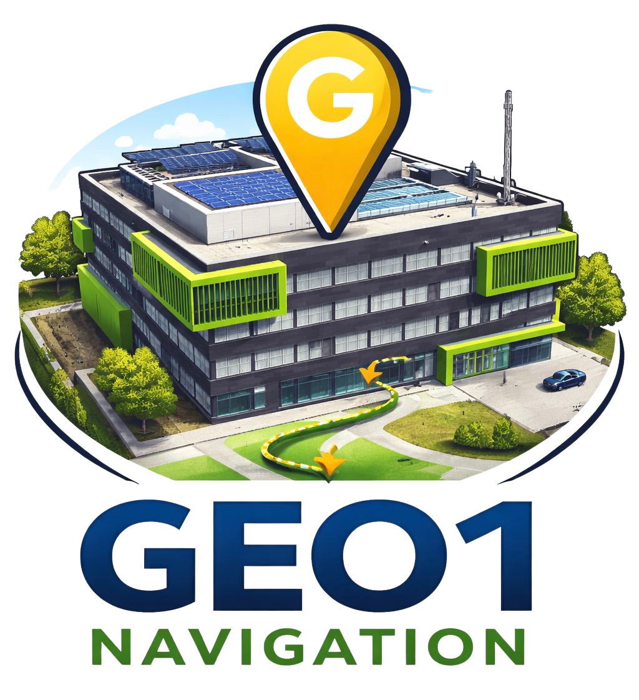

<a id="readme-top"></a>

<br />
<div align="center">
  <p align="center">
    
  </p>

  

  <p align="center">
    An indoor navigation system for the GEO1 building at the University of Münster
    <br />
    <a href="https://github.com/othneildrew/Best-README-Template"><strong>Explore the docs »</strong></a>
    <br />
    <br />
    <a href="https://github.com/othneildrew/Best-README-Template">View Demo</a>
    &middot;
    <a href="https://github.com/othneildrew/Best-README-Template/issues/new?labels=bug&template=bug-report---.md">Report Bug</a>
    &middot;
    <a href="https://github.com/othneildrew/Best-README-Template/issues/new?labels=enhancement&template=feature-request---.md">Request Feature</a>
  </p>
</div>

## Contributors

<p align="center">
  <a href="https://github.com/Hex-commits">
    
  </a>
  &nbsp;&nbsp;&nbsp;&nbsp;&nbsp;
  <a href="https://github.com/darianwwu">
    
      </a>
  &nbsp;&nbsp;&nbsp;&nbsp;&nbsp;
  <a href="https://github.com/pmunding">
    
  </a>
</p>

<!-- TABLE OF CONTENTS -->
<details>
  <summary>Table of Contents</summary>
  <ol>
    <li>
      <a href="#about-the-project">About The Project</a>
      <ul>
        <li><a href="#built-with">Built With</a></li>
      </ul>
    </li>
    <li>
      <a href="#getting-started">Getting Started</a>
      <ul>
        <li><a href="#prerequisites">Prerequisites</a></li>
        <li><a href="#installation">Installation</a></li>
      </ul>
    </li>
    <li><a href="#usage">Usage</a></li>
    <li><a href="#roadmap">Roadmap</a></li>
    <li><a href="#contributing">Contributing</a></li>
    <li><a href="#license">License</a></li>
    <li><a href="#contact">Contact</a></li>
    <li><a href="#acknowledgments">Acknowledgments</a></li>
  </ol>
</details>


## Projektstruktur

```
GIS-Search/
├── floorplans/          # PDF-Dateien der Stockwerke
├── src/
│   ├── frontend/        # Frontend-Dateien
│   │   ├── index.html   # Haupt-HTML-Datei
│   │   ├── styles.css   # Styling
│   │   └── app.js       # JavaScript-Logik
│   └── llm/
│       ├── app.py       # FastAPI Backend
│       └── ...
└── pyproject.toml
```
### Built With


## Installation

1. Dependencies installieren via uv
```bash
uv sync
```

## Starting the server 


 > **Note:** A running Neo4j instance is required before using the application.

1. activate environtment
```bash
source .venv/bin/activate
```
2. start the server
```bash
uvicorn src.app:app
```
> **Note:** When running inside Docker, Uvicorn must be started with `--host 0.0.0.0` to be reachable from outside the container. The `--reload` option may not work reliably due to file system event limitations on mounted volumes.

```bash
uvicorn src.app:app --host 0.0.0.0 --port 8000
```

Server runs under: `http://localhost:8000`

## Features

### Chat-Interface (Links)
- ChatGPT-ähnliche Benutzeroberfläche
- Nachrichtenverlauf
- Auto-erweiterndes Eingabefeld
- Unterstützung für Enter zum Senden (Shift+Enter für neue Zeile)
- Loading-Indikator während der Anfragen

### PDF-Viewer (Rechts)
- Dropdown-Menü zur manuellen Stockwerk-Auswahl
- Automatische Anzeige des Stockwerks basierend auf Chat-Antworten
- Vollbildansicht der PDFs
- Unterstützte Stockwerke:
  - KG (Kellergeschoss)
  - EG (Erdgeschoss)
  - 1OG - 5OG (Obergeschosse)

## API-Endpunkte

- `GET /` - Frontend HTML
- `GET /api/ask?q=<query>` - Chat-Anfragen an den LLM-Agent
- `/static/*` - Statische Frontend-Dateien
- `/floorplans/*` - PDF-Dateien der Stockwerke

## Verwendung

1. Öffne `http://localhost:8000` im Browser
2. Stelle Fragen im Chat wie:
   - "Wo finde ich Raum 123?"
   - "Zeige mir das 2. Obergeschoss"
   - "In welchem Stockwerk ist Raum XYZ?"
3. Das entsprechende Stockwerk wird automatisch rechts angezeigt
4. Alternativ kannst du über das Dropdown-Menü manuell ein Stockwerk auswählen

## Technologie-Stack

- **Frontend**: Vanilla JavaScript, HTML5, CSS3
- **Backend**: FastAPI (Python)
- **LLM**: Integration mit bestehendem Agent-System
- **PDF-Anzeige**: Native Browser PDF-Viewer (iframe)

<p align="right">(<a href="#readme-top">back to top</a>)</p>
